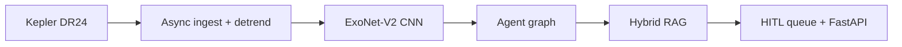

<div align="center">

# 🪐 ExoMind-X Enterprise
**Autonomous multi-agent exoplanet discovery & astrophysics RAG platform**

    

</div>

Classifies Kepler transit signals with a dual-branch 1D-CNN, vets ambiguous cases with a multi-agent graph, grounds verdicts with hybrid retrieval, and routes uncertain cases to an expert queue.



## Features
| Layer | What it does |
|---|---|
| Ingestion | Grouped 80/10/10 split by `kepid`, transit-masked `flatten(401)`, parquet cache |
| Model | Global (2001) + local (201) views + 3 metadata features; MLflow, ONNX export |
| Agents | Ingestion → Classifier → Diagnostic → RAG, with secondary-eclipse and V-shape checks |
| RAG | BM25 live today; Qdrant dense + RRF planned |
| HITL | 0.45 ≤ P ≤ 0.55 routed to expert labeling |
| Security | Token-bucket rate limiter, hardened headers, non-root Docker |
| Observability | Prometheus `/metrics`, tests + GitHub Actions CI |

## API
`POST /api/v1/predict` · `POST /api/v1/agent/analyze` · `POST /api/v1/batch` · `GET /api/v1/rag/search` · `GET /api/v1/model` · `GET /api/v1/hitl` · `POST /api/v1/hitl/label` · `GET /metrics` · `/docs`

## Quickstart
```bash
pip install -r requirements.txt && cd backend && uvicorn main:app --reload
```
Docker: `docker build -t exomind . && docker run -p 10000:10000 exomind`
Deploy: import the repo on Vercel (Framework: Other), or use `render.yaml` on Render.
Tests: `pip install -r requirements-dev.txt && pytest`

> **Honesty note:** the live demo uses a transparent heuristic scorer. `ml/model.py` is the PyTorch ExoNet-V2 reference intended to replace it via ONNX. Vercel is stateless, so the HITL queue is best-effort there.

## Author
**Nikhil Chary Sriramoju**, final-year B.Tech CSE, building agentic AI, RAG and security platforms. [GitHub](https://github.com/Nikhil-creat) · [LinkedIn](https://in.linkedin.com/in/nikhil-chary-sriramoju-95041b38a) · sriramojunikhil66@gmail.com
